```mermaid
flowchart TD
    client([Client /<br/>other API service]) -->|GET /coverage or /coverage/RW| api[api.R<br/>Plumber route]
    api --> get[get_coverage_geojson&#40;country&#41;<br/>R/coverage.R]

    get --> cache{cached in<br/>.data_cache?}
    cache -->|yes| geojson[[GeoJSON string]]
    cache -->|no, first request| build[build_country_footprint&#40;country&#41;<br/>for each country if &#123;all&#125;]

    build --> yieldrds[(Yield RDS<br/>data/yield/*.RDS<br/>lon/lat columns)]
    yieldrds --> pts[unique&#40;lon, lat&#41; grid cells]
    pts --> buffer[one 0.05° square<br/>per grid cell]
    buffer --> union[planar sf::st_union<br/>+ drop collinear vertices]
    union --> sfobj[[sf polygon:<br/>country, n_cells, geometry]]
    sfobj --> towrite[sf_to_geojson&#40;&#41;<br/>write to temp file, read back as string]
    towrite --> cache

    geojson -->|Content-Type: application/geo+json| client
```

# Data Flow

How a request moves through the system, and where each piece of data comes from. See [ONBOARDING.md](ONBOARDING.md) for the narrative walkthrough and [API-REFERENCE.md](API-REFERENCE.md) for the request/response schema.

---

## `POST /compute` — recommendation request

```mermaid
flowchart TD
    client([Client]) -->|POST /compute JSON| api[api.R<br/>Plumber route]
    api --> run[run_akilimo&#40;postBody&#41;<br/>AkilimoMain.R]

    run --> validate{validate_request&#40;body&#41;}
    validate -->|field/range checks fail| err400[["400 Bad Request"]]
    validate -->|is_point_covered&#40;country, lon, lat&#41;<br/>fails — get_data.R| err400
    validate -->|OK| parse[parse_request&#40;body&#41;<br/>normalise fields, area → ha]

    parse --> tmp[setup_temp_dir&#40;&#41;<br/>temp/&#123;timestamp&#125;_&#123;COUNTRY&#125;_&#123;TYPE&#125;_&#123;rand&#125;/]
    tmp --> dispatch{dispatch_recommendations&#40;&#41;<br/>FR → IC → PP → SP priority}

    dispatch -->|FR| procFR[process-FR.R]
    dispatch -->|IC| procIC[process-IC.R<br/>NG maize / TZ sweet potato]
    dispatch -->|PP| procPP[process-PP.R]
    dispatch -->|SP| procSP[process-SP.R]

    subgraph dataLayer [Data Layer — get_data.R, cached per process]
        soil[(Soil NPK RDS<br/>data/soil/*.RDS)]
        yield[(Yield WLY<br/>NetCDF / RDS<br/>data/yield/*)]
        prices[(Prices<br/>SQLite + CSV defaults)]
        trns[(translations.csv)]
    end

    procFR --> soil
    procFR --> yield
    procIC --> soil
    procIC --> yield
    procPP --> prices
    procSP --> soil
    procSP --> yield

    procFR --> quefts[QUEFTS&#40;&#41;<br/>R/quefts.R<br/>yield at candidate NPK rates]
    procIC --> quefts
    procSP --> quefts
    quefts --> optim[run_Optim_*&#40;&#41;<br/>R/optimize_fert.R<br/>maximise net revenue]

    optim --> tr1[tr&#40;key, lang, …&#41;<br/>R/misc.R — build recommendation text]
    procPP --> tr1
    trns --> tr1

    tr1 --> result[[result list:<br/>rec_type, recommendation,<br/>data, fertilizers]]

    result --> pdf{generate_pdfs&#40;&#41;<br/>R/email.R}
    pdf --> build[build_fr/ic/pp/sp_pdf&#40;&#41;<br/>R/pdf_builders.R + html_helpers.R]
    build --> weasy[WeasyPrint<br/>system2&#40;&#41; call]
    weasy --> pdfout[(PDF files<br/>in temp dir)]
    pdf -->|failure: logged, never blocks response| result

    pdfout --> email{email requested?}
    email -->|yes| send[sendEmailReport&#40;&#41;<br/>smtp / mailtrap / mailgun]
    email -->|no| resp
    send --> resp[build_response&#40;result&#41;]

    resp -->|200 success JSON| client
```

**Key properties:**
- Validation fails fast — the coverage check (`is_point_covered()`) runs *before* any spatial data is loaded, so an out-of-range coordinate never reaches a processor.
- Every processor hits the same `get_data.R` cache (`.data_cache`); soil/yield/price files are read from disk once per server process, not once per request.
- PDF and email failures are caught and logged but never suppress the JSON recommendation — `result` is built independently of `pdf`/`email` outcomes.

---

## `GET /coverage`, `GET /coverage/<country>` — coverage footprints

**Key properties:**
- Uses the **same yield grid** as `is_point_covered()` in `get_data.R` — the polygon a client sees from `/coverage` is exactly the area `/compute` will accept.
- Computed once per server process and cached; the underlying yield grids never change at runtime, so there's no need to rebuild per request.
- The footprint traces the actual covered cells (union of exact cell squares), not a bounding box — countries aren't rectangles.

---

## Data sources at a glance

| Source | Format | Location | Loaded by |
|--------|--------|----------|-----------|
| Soil NPK | RDS | `data/soil/{COUNTRY}_FCY{1-5}_soilNPK.RDS`, `SoilData_4Country.RDS`, `predicted_soil_properties.rds` | `get_soil_data()` |
| Yield (WLY) | NetCDF (NG/TZ/GH) + RDS (all 5) | `data/yield/{COUNTRY}_WLY_LINTUL_2020SP.nc`, `{Country}_WLY_LINTUL*.RDS` | `get_yield_data()`, `get_WLY_15M_ncdf()` |
| Coverage footprints | Derived (sf polygons) | Built from the yield RDS above, not stored on disk | `get_coverage_geojson()` |
| Translations | CSV (wide: key × lang) | `data/input/translations.csv` | `get_input_data("TRNS")` → `tr()` |
| Default/starch prices | CSV + SQLite | `data/input/*.csv`, `data/input/akilimo_compute.sqlite` | `get_default_prices()`, `get_starch_prices()` |
| Fertilizer NPK content | CSV | `data/input/fertilizer_npk.csv` | `get_input_data("fertilizer_npk")` |
| Dry matter curve | CSV | `data/input/fd2.csv` | `get_input_data("dry_matter")` |

All of the above are cached in `.data_cache` after first read (see `cached_read()` in `R/get_data.R`) — a server process reads each static file from disk exactly once.
